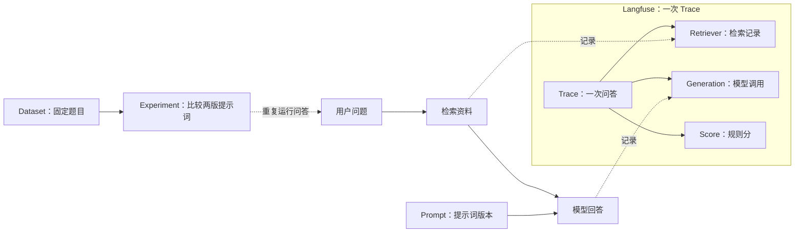

# Langfuse 入门示例

Langfuse 像 AI 应用的“运行记录本”：一次提问是一条 **Trace**，其中可以看到检索、模型调用、耗时和 Token 用量。它还可以关联提示词版本、给回答打分，并用固定题目比较改动前后的表现。



## 按顺序运行

在**项目根目录**安装根目录的依赖，并在根目录 `.env` 中配置 `LANGFUSE_PUBLIC_KEY`、`LANGFUSE_SECRET_KEY`、`LANGFUSE_BASE_URL`。调用 Qwen 时还需配置 `ALIYUN_API_KEY`。

```powershell
pip install -r requirements.txt
python -m langfuse_demo.first_trace
python -m langfuse_demo.rag_with_tracing
python -m langfuse_demo.prompt_experiment --init
python -m langfuse_demo.prompt_experiment
python -m langfuse_demo.prompt_experiment --experiment
```

- `first_trace.py`：在一条 Trace 中比较自动模型追踪、装饰器与手动埋点。终端会打印 Trace ID、父子路径和可用时的页面链接；没有 Qwen Key 时仍可运行函数埋点。
- `rag_with_tracing.py`：用内置资料模拟检索，观察 Retriever 和 Generation。
- `prompt_experiment.py`：创建两版 Prompt 和 Dataset，记录引用规则分，再比较两版结果。规则分只检查引用格式，不代表答案一定正确。
- `qa_agent_with_tracing.py`：**进阶选学**，运行 `python -m langfuse_demo.qa_agent_with_tracing`，查看 Agent 工具调用和多轮会话追踪。

`common.py` 放共用配置；测试在 `tests/`。运行后到 Langfuse 的 **Traces、Prompts、Datasets、Experiments** 页面查看记录。

首次运行后，在终端找到 **Trace ID**。打开输出的链接；若没有链接，就在 Langfuse 的 **Traces** 页面按该 ID 查找。页面中的 `first-trace-demo` 是父 Span；模型调用是自动记录的 Generation，另两个 Span 分别来自装饰器和手动创建。后两种规范化操作会得到相同结果，区别在于**记录方式**；Generation 则有模型名和 Token 用量。
