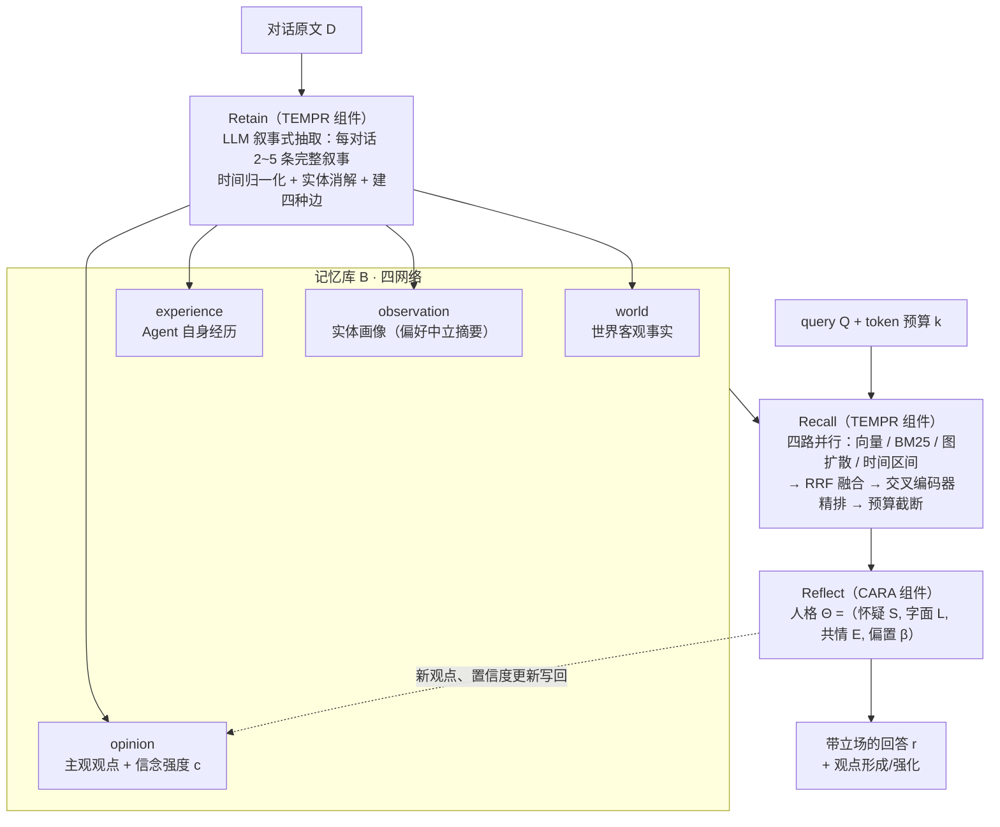
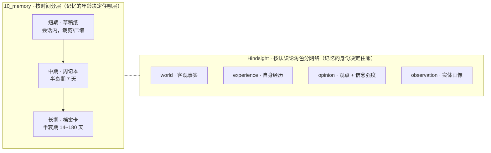
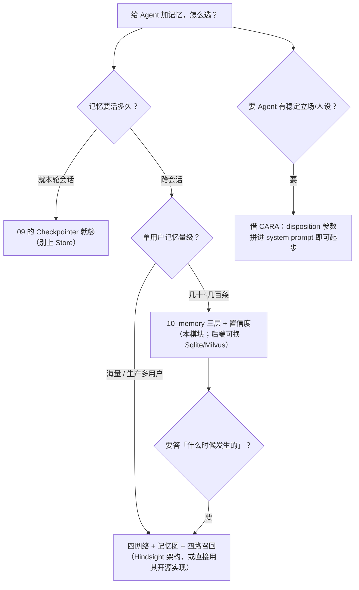

# Hindsight vs 10_memory：Agent 记忆架构设计思想对比与落地指南

> 对照材料：**Hindsight 技术报告**——《Hindsight is 20/20: Building Agent Memory that Retains, Recalls, and Reflects》（Vectorize.io / Washington Post / Virginia Tech，arXiv:2512.12818，2025-12；课堂材料 `Day19/hindsight.pdf`；开源实现 github.com/vectorize-io/hindsight）
>
> 本模块：`10_memory/` 三层记忆 + 置信度机制（LangGraph 教学版）。
>
> 一句话定位：**10_memory 教的是「记忆怎么存、怎么信」的最小闭环；Hindsight 展示的是「记忆作为推理基底」的生产完整形态。**

## 1. Hindsight 五分钟速览

Hindsight 的核心主张：**记忆不是挂在 LLM 外面的检索外挂（RAG），而是 Agent 推理的一等结构化基底**。它把记忆组织成四个「逻辑网络」，用三个「核心操作」读写，再用一个可配置的「人格层」生成带立场的回答。

**四个网络**（按认识论角色划分：这条记忆是谁说的、是事实还是看法）：

| 网络 | 存什么 | 例子 | 带置信度？ |
|------|--------|------|-----------|
| world | 关于外部世界的客观事实 | 「Alice 在 Google 的 AI 团队上班」 | 否（事实就是事实） |
| experience | Agent 自身经历（第一人称） | 「我给 Alice 推荐了优胜美地」 | 否 |
| opinion | Agent 的主观判断 | 「Python 更适合数据科学」 | 是（c=0.85，信念强度） |
| observation | 从多条事实合成的实体画像 | 「Alice 是专攻 ML 的软件工程师」 | 否（偏好中立的摘要） |

**三个操作**：

- **Retain**（TEMPR 实现）：LLM 把对话抽成**叙事式事实**（每次对话 2~5 条自包含叙事，不是碎句子），把「上周」归一化成日期区间、把「我室友」消解成 Emily，并建四种边（时间/语义/实体/因果）连成记忆图；顺带触发观点强化与画像异步重生成。
- **Recall**（TEMPR 实现）：**四路并行检索**（向量 / BM25 关键词 / 图扩散激活 / 时间区间）→ RRF 排名融合 → 交叉编码器精排 → **按 token 预算截断**——调用方声明「最多给多少 token」，系统保证不超。
- **Reflect**（CARA 实现）：人格参数 Θ=(怀疑度 S，字面度 L，共情度 E，偏置强度 β)（前三者 1~5，β∈[0,1]）。同一个记忆库：S=1 的 Agent 说「远程工作解放了创造力」，S=5 的说「远程工作侵蚀问责制」——**事实相同、观点不同，且观点置信度随新证据自动演化**。

**成绩**（为什么值得学）：同一个开源 20B 模型（GPT-OSS-20B，单张消费级 GPU 可跑），LongMemEval 总分 **39% → 83.6%（+44.6 分）**，反超 Full-context GPT-4o（60.2%）；其中多会话推理 21.5%→79.7%、时间推理 31.6%→79.7%、偏好运用 20.0%→66.7%。换 Gemini-3 只当答案生成器后：LongMemEval 91.4%、LoCoMo 89.61%，而此前最强的开源记忆系统只有 75.78%。结论很硬：**架构收益 > 模型规模**。

## 2. 设计思想对比

### 2.1 最核心的分歧：分层（分网络）的轴完全不同

- 10_memory 按**时间/生命周期**分层——人类心理学的隐喻（工作记忆/短期/长期），一条记忆的「年龄」决定它住哪层、衰减多快。
- Hindsight 按**认识论角色**分网络——知识表示的思路，一条记忆的「身份」（客观事实？我的经历？我的观点？合成摘要？）决定它存哪。
- **两根轴是正交的，不是竞争关系**。最有意思的对照是「时间」：Hindsight 根本没有「中期记忆」这一层——时间在它那里不是层，而是**每条事实身上的字段**（出现区间 [τs,τe] + 提及时间 τm）**加一条检索通道**（能答「六月发生了什么」）。10_memory 把时间做成「层」（周摘要、半衰期），直观好教；Hindsight 把时间做成「字段+索引」，表达力更强。

### 2.2 六个不谋而合的共同直觉

两套系统一个在课堂、一个在生产，但核心直觉高度一致——这六条可以当作「Agent 记忆设计」的通用心法：

| # | 共同直觉 | 10_memory 的实现 | Hindsight 的实现 |
|---|---------|-----------------|-----------------|
| 1 | **证据与推断必须分开** | `source` 字段打分：亲口说 0.90 vs Agent 推断 0.50 | 四网络**结构级**分离：fact 与 opinion 不住同一个网络 |
| 2 | **记忆是轨迹，不是标签** | `judge_relation` 四关系调分 + revision/evidence 留痕 | opinion 置信度随证据 reinforce / weaken / contradict 演化 |
| 3 | **时间要进模型** | `last_accessed_at` 半衰期衰减 + 周摘要按周淡出 | 出现区间 + 提及时间双时间戳 + 时间检索通道 |
| 4 | **「记什么」与「怎么说」解耦** | 四档状态定措辞（trusted 直接说 / pending_verify 标待确认） | CARA 人格参数 (S,L,E,β) 参数化回答风格 |
| 5 | **宁可不记，不可污染** | `unrelated` 拒写；低分 archived 不注入 | 事实类型严格分类；observation 强制偏好中立 |
| 6 | **结构先于检索** | 先定 schema（稳定语义键/置信度/半衰期）再谈召回 | 先建四网络 + 四种边，再谈四路检索 |

### 2.3 四个值得玩味的分歧

**① 置信度的语义不一样（最容易混淆的点）**

- 10_memory 的 `confidence` 是**认识论置信度**：「这条信息有多可信」——为召回排序和注入措辞服务。
- Hindsight 的 opinion `confidence` 是**信念强度**：「Agent 自己多坚定地持这个观点」——它允许观点是错的，但要区分「深信不疑」和「勉强认同」。world fact 默认**不带**置信度（事实就是事实，靠时间区间管新鲜度）。
- 教学必点破：**同为 0.85，一个是「我 85% 确信这是真的」，一个是「我 85% 坚定这么认为」**。

**② 遗忘：课程模块反而走到了论文前面**

- 10_memory 有完整遗忘机制：指数衰减 + FLOOR 0.05 + archived 归档 + confirm 复活——「用进废退、遗忘可逆」。
- Hindsight 论文结论把 **controlled forgetting / time-aware belief revision** 明确列为 future work——它只有「观点降分」，没有「记忆淡忘」。
- 这是个极好的综合练习题：让学生从 10_memory 出发，反过来给 Hindsight 的 opinion 网络补上「时间衰减 + 归档复活」。

**③ 重排哲学：让不让「可信度」参与排序？**

- 10_memory：`final = 0.6×相似度 + 0.3×有效置信度 + 0.1×新近度`——可信度直接进分数，高相似但低可信的条目会被压下去。
- Hindsight：RRF 融合四路排名 + 交叉编码器精排——**排序只看相关性**，置信度/信念强度不参与（事实网络里都是「事实」，不存在谁比谁可信；信念强度留给生成阶段去措辞）。
- 两种哲学各有道理：课程助手记忆质量参差（推断混在里面），让置信度参与排序收益大；生产系统把质量关卡**前移**到入库（类型分类 + 叙事抽取），检索就专心做相关性。

**④ 摘要层的聚合方向相反**

- 10_memory：中期按**时间**聚合（同周会话合并成一篇周记）；长期画像是**原子事实卡**（一张卡一个事实，稳定 key 防膨胀）。
- Hindsight：observation 按**实体**聚合（每个实体一份 LLM 合成的偏好中立画像，后台异步重生成）。
- 取舍：原子卡精确、可审计、永不漂移，但「这学生是个怎样的人」要拼多条；合成画像读起来像人物简介，适合整体问题，但会漂移、需要重生成。生产常见双轨：原子事实为准 + 合成画像作索引（呼应 06 文件「Store 为准 + Milvus 作检索索引」的双写思路）。

### 2.4 关系判断规则几乎同构

两套系统在新旧记忆冲突处理上几乎一一对应：

| 10_memory `judge_relation` | Hindsight `Assess` | 调分 |
|---------------------------|--------------------|------|
| confirm（证实） | reinforce | 10_memory：+0.05~0.10；Hindsight：c′=min(c+α, 1.0) |
| supplement（补充合并） | （无直接对应；画像走 Merge_LLM） | +0.05 |
| contradict（矛盾 → 归档+继承） | contradict | 10_memory：−0.30 且旧卡归档；Hindsight：c′=max(c−2α, 0.0) |
| unrelated（拒写防污染） | neutral（不动） | 0 |

共同点：**都重罚矛盾、轻奖确认**（10_memory 奖惩比约 1:3~1:6，Hindsight 固定 1:2）。分歧点：10_memory 封顶 0.95 永不留满分（「再确信也留 5% 怀疑」），Hindsight 允许信念到 1.0；10_memory 矛盾时旧条目**归档保留可复活**，Hindsight 只降置信度不改表述（表述修订只在 background merging 里做）。

## 3. 如何实际应用

### 3.1 三种应用姿势

**姿势 A：当教学参照系（最推荐）**

1. 顺序：先用 10_memory 跑通最小闭环（零成本、可测、可改），再把 Hindsight 论文当「生产级长什么样」的对照阅读。
2. 照着 LongMemEval 的五类题（信息抽取 IE / 多会话推理 MR / 时间推理 TR / 知识更新 KU / 拒答 ABS）给自己的学习助手出 20 道测评题。预判：**KU**（知识更新）10_memory 能答好（contradict 归档+继承就是为此设计的）；**TR**（时间推理）答不好（记忆没有出现区间）；**ABS**（拒答）靠 pending_verify 的「待确认」措辞勉强及格。**哪里失分，哪里就是 Hindsight 对应组件的价值。**
3. 测试策略也是双份的：10_memory 的 50 个确定性单测保「机制正确」，LongMemEval 式题组保「效果达标」——生产系统两样都要。

**姿势 B：把 Hindsight 思想低成本移植进 10_memory（动手改造清单）**

按性价比排序，每条注明改哪里：

| 优先级 | 改造 | 动哪个文件/函数 | Hindsight 对应 | 工作量 |
|-------|------|----------------|---------------|--------|
| 1 | 记忆加 `epistemic_type` 字段（fact/experience/opinion），注入块分段渲染「我知道的 / 我推断的 / 我持的观点」 | `memory_store.make_entry` + `render_memory_block` | 四网络 | 半天 |
| 2 | 叙事式抽取：consolidate 的候选事实改为 LLM 输出 2~3 条自包含叙事（含时间），不再让模型挑 key | `05 consolidate_memory` 的 pending_facts 约定 | narrative extraction | 半天 |
| 3 | 第二检索通道（BM25，jieba 已是依赖）+ RRF 融合 | `memory_store.recall` 前加一路 `bm25_candidates()` | 四路并行 + RRF | 1 天 |
| 4 | token 预算装填：记忆块按 final_score 从高到低装填，直到预算用完 | `render_memory_block` 加 budget 参数 | 论文 Eq.17 预算截断 | 2 小时 |
| 5 | 时间区间：entry 加 `occurred_start/end`（「上周刚做完练习」归一化成日期），recall 支持时间过滤 | `make_entry` + `recall` | temporal 通道 | 1 天 |
| 6 | 人格参数：把注入块的【使用规则】改成由 (S,L,E,β) 生成的措辞，得到「严格助教 / 耐心助教」两套配置 | `render_memory_block` | CARA verbalization | 半天 |

> 做完 1+3+4，课程版就具备了 Hindsight 六成的工程骨架；再补 2+5（叙事与时间），就是论文 Retain/Recall 的教学复刻。

**姿势 C：选型决策**

### 3.2 不建议照搬的三个部件

| 部件 | 为什么生产值得 | 为什么教学先跳过 |
|------|---------------|----------------|
| 交叉编码器精排 | 精度最高，但要跑第二个模型，有延迟和成本 | qwen3.5:2b / qwen-plus 场景收益有限 |
| 图扩散激活检索 | 多跳发现能力强，但要图索引和边的维护 | Milvus 标量过滤已覆盖教学需求（06 文件） |
| 后台异步重生成画像 | 写入路径保持低延迟 | 需要任务队列，超出课程范围 |

### 3.3 一句话总结

> 10_memory 教「记忆怎么存、怎么信」的最小闭环；Hindsight 展示「记忆作为推理基底」的完整生产形态。两者共享同一套价值观——**证据与推断分开、记忆随证据演化、时间是一等公民、结构先于检索**——差别只在工程预算。先跑通小的，再对照大的，缺什么补什么。
